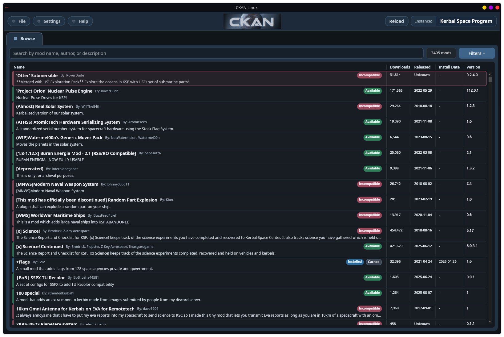

# CKAN LinuxGUI


A native Linux desktop app for the Comprehensive Kerbal Archive Network (CKAN), the mod manager for Kerbal Space Program. Built with Avalonia on top of the upstream CKAN core.



> **Review removals before applying:** Removing a mod may also remove mods that
> depend on it. Check the Auto-Removals section in Review; use **Keep** for
> anything you intend to preserve.

> **Known issue:** May report a crash when closing.

## Status

LinuxGUI is under passive development.

## Installation

CKAN Linux is available for **x86-64 Linux**. Choose the installation method
for your distribution:

### Ubuntu, Debian, Fedora, and similar distributions

A [graphical installer beta](https://github.com/appaKappaK/CKAN-LinuxUI/releases/tag/ckan-linux-installer-beta.1)
is available for common Linux systems. Download and extract the ZIP,
then open `CKAN-Linux-Installer`. Some file managers may ask to allow it
to run first. The download includes the app and does not require Git or the
.NET SDK. The installer is a beta; compatibility can vary by distribution.

It installs CKAN Linux under `~/.local` without replacing an existing `ckan`
command. Find it in your application menu, or run `~/.local/bin/ckan-linux`.

### NixOS

The Nix package is available from the `dev` branch. It has been tested on
NixOS with KSP instance registration and mod installation. The graphical
installer above does not run on a default NixOS setup.

To install it, open a terminal and run:

```bash
git clone -b dev https://github.com/appaKappaK/CKAN-LinuxUI.git
cd CKAN-LinuxUI
nix --extra-experimental-features 'nix-command flakes' profile add .#default
```

Launch **CKAN Linux** from your app menu, or run `ckan-linux`. If it doesn't
appear in the app menu immediately, log out and back in. If both
`nix-command` and `flakes` are already enabled, the
`--extra-experimental-features` option can be left out. The package uses a
Nix profile rather than the `~/.local` installer.
After installation, you can delete the cloned `CKAN-LinuxUI` folder. Keep it
if you want to update from the same checkout later.

To remove the package installed using the commands above, run:

```bash
nix --extra-experimental-features nix-command profile remove CKAN-LinuxUI
```

To reinstall or update it, first remove it with the command above. Then, from
inside the cloned `CKAN-LinuxUI` folder, run:

```bash
git pull --ff-only
nix --extra-experimental-features 'nix-command flakes' profile add .#default
```

If you deleted the clone, use the install commands above to clone it again.
Removing the package does not remove your game files or CKAN's game-instance
data. If the application menu still shows an old entry, log out and back in.

### Build from source

On conventional Linux distributions, you can also build and install from source
using Git and the .NET 8 SDK:

```bash
git clone -b dev https://github.com/appaKappaK/CKAN-LinuxUI.git
cd CKAN-LinuxUI
./scripts/install-linuxgui.sh
~/.local/bin/ckan-linux
```

## What This Fork Adds

- A native Linux desktop app, launched as `ckan-linux`.
- A separate `ckan-linux` command that does not replace an existing `ckan`
  installation.

The former WinForms and terminal interfaces are not included in this fork.

## Development

Build steps, packaging, the dev launcher, logs, and the visual-test
workflow are documented in [`LinuxGUI/README.md`](LinuxGUI/README.md).
An optional CLI build for scripting and recovery is described in
[`doc/building.md`](doc/building.md).

Report problems with the Linux app on this repository's
[issue tracker](https://github.com/appaKappaK/CKAN-LinuxUI/issues/new).

## About CKAN

CKAN is a metadata repository and set of tools for finding, installing, and
managing Kerbal Space Program mods. It installs mods the way their metadata
prescribes, for the right game version, with their dependencies, and without
conflicts. It was inspired by the metadata formats of Debian and CPAN.

This fork carries the upstream CKAN core and adds the LinuxGUI shell. Core
development, metadata policy, and command-line behavior come from the
[upstream CKAN project](https://github.com/KSP-CKAN/CKAN), which is under
[active development](https://github.com/KSP-CKAN/CKAN/commits/master).

- [Upstream user guide](https://github.com/KSP-CKAN/CKAN/wiki/User-guide):
  useful for CKAN concepts, though its screenshots and layout will not match
  this app
- [Upstream releases](https://github.com/KSP-CKAN/CKAN/releases/latest)
- [Metadata specification](Spec.md) and its
  [JSON Schema](CKAN.schema), also available in the
  [Schema Store](https://schemastore.org/)
- [Validating metadata files](https://github.com/KSP-CKAN/CKAN/wiki/Adding-a-mod-to-the-CKAN#verifying-metadata-files)
- Mod authors: if the metadata for your mod is wrong,
  [open an issue](https://github.com/KSP-CKAN/NetKAN/issues/new)
- Contributing to CKAN metadata or core: see the upstream
  [CONTRIBUTING](https://github.com/KSP-CKAN/.github/blob/master/CONTRIBUTING.md)
  file

## License and Thanks

See [`LICENSE.md`](LICENSE.md). This fork builds on the work of the
[KSP-CKAN](https://github.com/KSP-CKAN/CKAN) project and its contributors.

---

Looking for the open-data portal software also called CKAN? Its repository is
[here](https://github.com/ckan/ckan).
