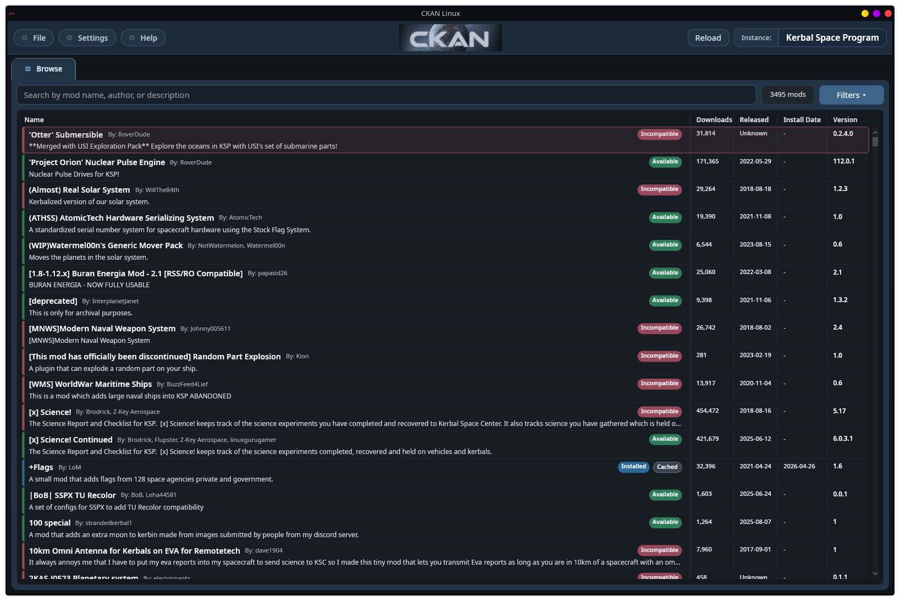

# CKAN LinuxGUI


A native Linux desktop app for the Comprehensive Kerbal Archive Network (CKAN), the mod manager for Kerbal Space Program. Built with Avalonia on top of the upstream CKAN core.



> **Review removals before applying:** Removing a mod may also remove mods that
> depend on it. Check the Auto-Removals section in Review; use **Keep** for
> anything you intend to preserve.

## Status

LinuxGUI is under passive development.

## Installation

A [graphical installer beta](https://github.com/appaKappaK/CKAN-LinuxUI/releases/tag/ckan-linux-installer-beta.1)
is available for Linux x64. Download and extract the ZIP, then open
`CKAN-Linux-Installer`. It includes the app and does not require Git or the
.NET SDK.

Alternatively, install from source using Git and the .NET 8 SDK:

```bash
git clone https://github.com/appaKappaK/CKAN-LinuxUI.git
cd CKAN-LinuxUI
./scripts/install-linuxgui.sh
```

The installer puts CKAN Linux under `~/.local` without replacing an existing
`ckan` command. Find it in your application menu, or launch it directly:

```bash
~/.local/bin/ckan-linux
```

## What This Fork Adds

- A native Linux desktop app, launched as `ckan-linux`.
- A queue-and-review workflow: installs, updates, removals, and downloads are
  queued first, and Review shows what will happen (including dependencies)
  before anything is applied.
- A separate `ckan-linux` command that does not replace an existing `ckan`
  installation.

The former WinForms and terminal interfaces are not included in this fork.

## Development

Build steps, packaging, the dev launcher, logs, and the visual-test
workflow are documented in [`LinuxGUI/README.md`](LinuxGUI/README.md).
An optional CLI build for scripting and recovery is described in
[`doc/building.md`](doc/building.md).

Report problems with the Linux app on this repository's
[issue tracker](https://github.com/appaKappaK/CKAN-LinuxUI/issues/new).

## About CKAN

CKAN is a metadata repository and set of tools for finding, installing, and
managing Kerbal Space Program mods. It installs mods the way their metadata
prescribes, for the right game version, with their dependencies, and without
conflicts. It was inspired by the metadata formats of Debian and CPAN.

This fork carries the upstream CKAN core and adds the LinuxGUI shell. Core
development, metadata policy, and command-line behavior come from the
[upstream CKAN project](https://github.com/KSP-CKAN/CKAN), which is under
[active development](https://github.com/KSP-CKAN/CKAN/commits/master).

- [Upstream user guide](https://github.com/KSP-CKAN/CKAN/wiki/User-guide):
  useful for CKAN concepts, though its screenshots and layout will not match
  this app
- [Upstream releases](https://github.com/KSP-CKAN/CKAN/releases/latest)
- [Metadata specification](Spec.md) and its
  [JSON Schema](CKAN.schema), also available in the
  [Schema Store](https://schemastore.org/)
- [Validating metadata files](https://github.com/KSP-CKAN/CKAN/wiki/Adding-a-mod-to-the-CKAN#verifying-metadata-files)
- Mod authors: if the metadata for your mod is wrong,
  [open an issue](https://github.com/KSP-CKAN/NetKAN/issues/new)
- Contributing to CKAN metadata or core: see the upstream
  [CONTRIBUTING](https://github.com/KSP-CKAN/.github/blob/master/CONTRIBUTING.md)
  file

## License and Thanks

See [`LICENSE.md`](LICENSE.md). This fork builds on the work of the
[KSP-CKAN](https://github.com/KSP-CKAN/CKAN) project and its contributors.

---

Looking for the open-data portal software also called CKAN? Its repository is
[here](https://github.com/ckan/ckan).
